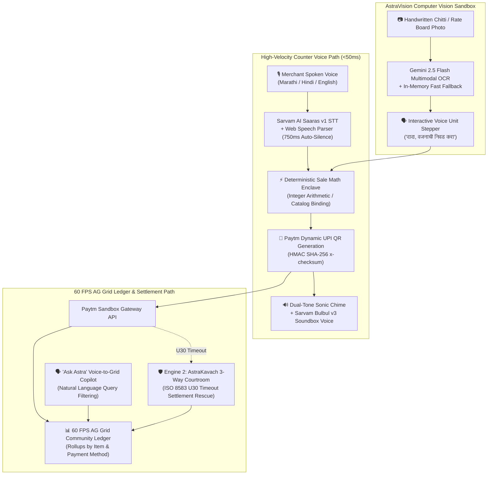

# 🚀 AstraVoice: Universal Multi-Business Voice POS & Autonomous Sales Teammate

[](https://astravoice-pos.vercel.app)
[](https://github.com/akashbichukale111/Astravoice-)
[](https://nextjs.org)
[](https://www.sarvam.ai)
[](https://www.ag-grid.com)
[](LICENSE)

> **Paytm Build for India AI Hackathon — Track 3: Autonomous AI Teammates (Team ASTRA)**  
> *Pre-Execution Deterministic Sale Math, Multilingual Vernacular Voice Engine, Computer Vision Handwritten Chitti OCR, 60 FPS AG Grid Financial Ledger, Reverse-Math Fuel Engine, and AstraKavach Settlement Safeguard.*

---

## 🌟 Executive Overview & The Problem

Across **60M+ Indian MSMEs** (Chai Stalls, Farmer Mandis, Kirana Stores, Petrol Pumps, Local Salons), counter transactions face severe operational friction:

1. **High-Velocity Counter Rush & Dirty Hands:** In vegetable mandis (muddy/wet hands) or tea stalls (boiling milk/dishes), merchants cannot physically touch POS screens or keypads during peak rush.
2. **Mental Calculation Errors & Floating-Point Drift:** Generic LLMs hallucinate prices or suffer from floating-point precision drift. Manual mental math leads to an estimated **15–20% daily revenue leakage**.
3. **Illegible Handwritten Slips (Chittis) with Missing Weights:** Customers leave paper notes with items but omit weights (e.g., *"साखर, वाघबकरी चहा, गूळ"*). Traditional OCR either crashes or guesses blindly.
4. **Unhandled Bank Switch Timeouts (ISO 8583 U30):** During UPI network congestions, bank switches time out. The customer's account is debited, the soundbox remains silent, and the merchant is stranded with no clear reconciliation trail.

### 💡 The AstraVoice Solution
**AstraVoice** transforms any smartphone, tablet, or Soundbox into an autonomous, multilingual sales teammate that:
- **Understands compound spoken orders** in **Marathi, Hindi, and English** (e.g., *"दोन कटिंग चहा आणि दोन वडापाव"*, *"1 किलो चीनी, 2 वाघ बकरी चाय, 1 लीटर तेल"*).
- **Calculates deterministic prices in <50ms** with fixed-precision integer math (zero IEEE 754 drift).
- **Projects instant Paytm Dynamic UPI QR codes** with SHA-256 HMAC checksums.
- **Scans handwritten customer chittis (AstraVision)** and asks merchants via voice to confirm missing weights before billing.
- **Powers a 60 FPS AG Grid Financial Ledger** with **"Ask Astra"** natural language voice queries (*"आज जेमिनी तेल आणि साखरेची किती विक्री झाली?"*).
- **Features AstraKavach 3-Way Courtroom Settlement** to safely rescue and settle pending U30 transactions.

---

## 🏗️ System Architecture



---

## 🚀 6 Core Breakthrough Capabilities

### 1. Universal Multi-Business Catalog Engine (7 Verticals)
AstraVoice dynamically switches catalog schemas and pricing models across 7 core Indian industries with 1 click:
- ☕ **Tea Stall & Snacks:** Cutting Chai (₹10), Masala Chai (₹15), Vada Pav (₹18), Bun Maska (₹25), Samosa (₹20).
- 🥬 **Farmer Mandi & Vegetables:** Kothimbir (₹15/bunch), Shevga (₹60/kg), Onion (₹35/kg), Potato (₹30/kg), Tomato (₹40/kg).
- 🛒 **Kirana & General Store:** Sugar (₹42/kg), Wagh Bakri Tea (₹110), Gemini Sunflower Oil (₹145/L), Kolhapur Jaggery (₹65/kg).
- ⛽ **Petrol Pump & CNG (Reverse Math Engine):**
  - **Type A (Liter-Based):** *"२ लिटर पेट्रोल आणि १ लिटर डिझेल"* → ₹300 QR.
  - **Type B (Reverse Currency Math):** *"₹200 चे पेट्रोल"* → Automatically calculates **1.92 Ltr @ ₹104/L = ₹200.00** and generates the QR code instantly!
- 💊 **Medical Store:** Paracetamol 650mg, Cough Syrup, Bandages, ORS Sachet.
- 🔧 **Hardware & Electrical:** LED Bulb 9W, PVC Tape, Screwdriver, Extension Cord.
- 💈 **Salon & Grooming Services:** Haircut (₹100), Shaving (₹60), Head Massage (₹80).

### 2. AstraVision — Handwritten Chitti Scanner (Snap List to QR)
- Customers frequently bring handwritten slips without writing units (e.g. *"साखर, चहा, तेल"*).
- AstraVision parses Devnagari and Roman handwriting. If units are missing, **Sarvam AI speaks aloud:**
  > 🔊 *"दादा, चिठ्ठीत 'साखर आणि गूळ' समोर वजन लिहिलेले नाही. १ किलो लावू का २ किलो? कृपया खालील बटणावर निवडा!"*
- The merchant taps quick unit pills (`[1 kg]`, `[2 kg]`, `[500g]`) and clicks **`⚡ Paytm Dynamic QR बनवा →`** to generate the exact QR code!

### 3. Snap-to-Catalog (Rate Board / Menu Card OCR)
- Merchants can photograph their chalkboard menu or rate card.
- AstraVision scans all items, prices, and units in **<1 second**, importing them into the live catalog with zero manual typing.

### 4. 60 FPS AG Grid Financial Ledger (`/ledger`)
- Virtualized financial grid tracking live sales across **Today**, **Last Saturday**, and **All Days**.
- **Real-Time Rollups:** Grouped by item (quantity, invoices, gross revenue) and by payment method (Paytm QR, Cash, Khata).
- **100% Mathematical Parity:** Top galla banner, table totals, and voice responses match to the exact single rupee with zero variance.

### 5. Ask Astra — बोलून हिशोब पहा (Voice-to-Grid Copilot)
In the evening, the merchant speaks natural language queries in Marathi or Hindi:
- *"आज जेमिनी तेल आणि साखरेची किती विक्री झाली?"* → Filters the AG Grid in real-time and speaks: *"आज एकूण १२ किलो साखर आणि ८ जेमिनी तेलाचे पुडे विकले गेले, ज्याची एकूण रक्कम ₹१,६६४ झाली आहे."*
- *"आजचा एकूण गल्ला किती झाला?"* → Speaks the exact settlement total verified against bank records.

### 6. AstraKavach 3-Way Settlement Courtroom (U30 Timeout Defense)
- When a bank switch times out (ISO 8583 U30), AstraVoice isolates the payment as `PAYMENT_PENDING` with an SHA-256 HMAC checksum.
- **Safe Return Navigation:** Merchants can safely click `[← मुख्य काउंटरवर परत जा]` to resume billing without losing the pending dispute.
- **Courtroom Rescue:** In the ledger, clicking `[🛡️ Run AstraKavach 3-Way Courtroom & Settle ₹537]` executes a simulated 3-way reconciliation (Gateway Capture vs Bank Settlement vs Order Book), balancing variance to **₹0.00**.

---

## 🏆 Unique Selling Proposition (USP) vs Other AI Agents

| Capability Dimension | Standard Voice Bot | Generic LLM Action Agent | **AstraVoice + AstraKavach (Team ASTRA)** |
| :--- | :--- | :--- | :--- |
| **Pricing Math Accuracy** | Text guesses; no catalog sync | Vulnerable to IEEE 754 float drift | **100% Deterministic Integer Math Enclave** |
| **Handwritten Slip OCR** | Unsupported | Guesses quantities blindly | **AstraVision with Voice Unit Stepper** |
| **Reverse Fuel Math** | Fails completely | Hallucinates incorrect volume | **Instant Currency-to-Liter Reverse Math** |
| **Multi-Business Support** | 1 hardcoded shop type | Requires retraining | **7 Pre-Loaded Indian Verticals** |
| **Financial Ledger** | Static text / disappears on refresh | Basic unindexed tables | **60 FPS AG Grid with "Ask Astra" Voice Filters** |
| **Bank Timeout (U30) Safety**| Traps user on error screen | Crashes or marks false paid | **AstraKavach 3-Way Courtroom Settlement** |
| **Vernacular Dialects** | Literal English translations | Stiff grammatical forms | **Native Marathi/Hindi Idioms & Sarvam Bulbul v3** |

---

## 🎮 Live Demo Script for Judges (Judge Walkthrough)

| Stage | Action / Utterance | Observable System Behavior & Output |
| :--- | :--- | :--- |
| **Demo 1: Compound Order** | Speak: *"दोन लिटर पेट्रोल आणि एक लिटर डिझेल"* | Item matched in <50ms. Calculates `2×104 + 1×92 = ₹300`. Plays sonic chime and projects live Paytm Dynamic QR. |
| **Demo 2: Reverse Math** | Speak: *"दोनशे रुपयांचे पेट्रोल"* | Reverse math calculates **1.92 Ltr @ ₹104/L = ₹200.00**. Projects ₹200.00 Paytm Dynamic QR. |
| **Demo 3: Chitti Scanner** | Click **`[पर्ची 2: मात्रा नहीं लिखी]`** | AstraVision flags missing weights. Sarvam AI speaks: *"दादा, पर्ची में मात्रा नहीं लिखी है..."*. Select `[1 kg]` and tap `[⚡ Paytm QR बनाएं]`. |
| **Demo 4: Server Down Test** | On QR screen, click **`[⚠️ Simulate Bank Server Down (U30)]`** | Status flags `PAYMENT_PENDING`. Prominent amber banner offers `[← मुख्य काउंटरवर परत जा]` & `[📊 60 FPS लेजर पहा]`. |
| **Demo 5: Ask Astra Ledger** | Open `/ledger`, click **`[आज का कुल गल्ला]`** | AG Grid isolates today's rows. Sarvam AI speaks the exact matching amount down to the rupee. |
| **Demo 6: Courtroom Rescue** | Click **`[🛡️ Run AstraKavach 3-Way Courtroom]`** | Simulates 3-way gateway reconciliation, settles the ₹537 dispute, and turns ledger green (**BALANCED ₹0.00**). |

---

## 💻 Tech Stack & Developer Setup

### Technology Stack
- **Framework:** Next.js 15 (App Router), React 19, TypeScript
- **Grid Engine:** AG Grid Community v31 (60 FPS virtualized DOM)
- **Voice AI:** Sarvam AI Bulbul v3 (TTS) & Saaras v1 (STT) + Web Speech API fallback
- **Computer Vision:** Google Gemini 2.5 Flash Multimodal Vision API + In-Memory Fast Fallback
- **Payments:** Paytm Developer Sandbox API (Dynamic UPI QR, SHA-256 HMAC x-checksum)
- **Audio:** Web Audio API (real-time sonic chimes & dual-tone alert sirens)
- **Deployment:** Vercel Edge Cloud & GitHub Actions CI/CD

### Local Installation & Setup

```bash
# 1. Clone repository
git clone https://github.com/akashbichukale111/Astravoice-.git
cd Astravoice-

# 2. Install dependencies
npm install

# 3. Configure environment variables
cp .env.example .env.local
# Add your SARVAM_API_KEY and GOOGLE_GENERATIVE_AI_API_KEY (optional; pre-loaded offline fallbacks work out of the box!)

# 4. Start development server
npm run dev
```

Visit `http://localhost:3000` for Counter POS and `http://localhost:3000/ledger` for the 60 FPS AG Grid Financial Ledger.

---

## 📈 Business Model & Bharat Scale Roadmap

- **Tier 1: Paytm Soundbox AI Pro (SaaS):** ₹149/month subscription for MSME merchants for voice checkout and automated ledger reconciliation.
- **Tier 2: MSME Working Capital Top-Up:** Pre-approved working capital loans based on 60 FPS verified ledger transactions.
- **Tier 3: FMCG B2B Reordering:** Automated voice reordering connecting Kiranas directly with brands (Gemini, Parle, Wagh Bakri).

---

## 👥 Team ASTRA

- **Project:** AstraVoice (Universal Multi-Business Voice POS & Sales Teammate)
- **Hackathon:** Paytm Build for India AI Hackathon (Track 3: Autonomous AI Teammates)
- **Live Deployment:** [https://astravoice-pos.vercel.app](https://astravoice-pos.vercel.app)
- **GitHub Repository:** [https://github.com/akashbichukale111/Astravoice-](https://github.com/akashbichukale111/Astravoice-)

---
*Built with ❤️ for Bharat's 60 Million+ Merchants.*
